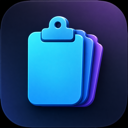
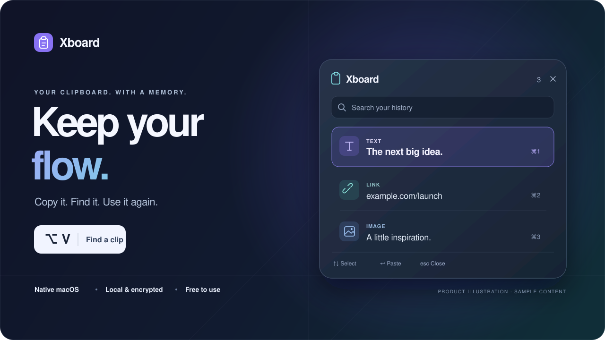

<div align="center">



# Xboard

### 複製過的靈感，隨時接得回來。

專為 macOS 打造的原生剪貼簿工具。<br />
按下 **⌥V**，找回文字、圖片與檔案，接著完成手上的事。

**免費使用** · **本機加密** · **繁體中文 / English** · **MIT 授權**

[開始使用](#quick-start)　·　[探索功能](#features)　·　[隱私設計](#privacy)　·　[常見問題](#faq)

</div>

<p align="center">
  
</p>

<p align="center"><sub>產品介面示意，使用虛構內容；實際外觀會依 macOS 版本與設定而異。</sub></p>

## 從「剛剛那段在哪裡」，到繼續你的下一步。

寫到一半的文案、查資料時複製的連結、準備貼進簡報的圖片——讓 Xboard 幫你留住，想用的時候再叫出來。少一次切回原頁面，就能多留一點注意力給真正想完成的事。

| **01　照常複製** | **02　按下 ⌥V** | **03　選取、貼上** |
| :--- | :--- | :--- |
| 沿用熟悉的 ⌘C，背景保存複製紀錄。 | 輸入關鍵字，或依類型、來源與日期篩選。 | ↑↓ 選取、Return 貼回原 App，Esc 關閉。 |

<sub>自動貼上需要 macOS「輔助使用」授權；未授權時，選取後仍可手動按 ⌘V。</sub>

<a id="features"></a>

## 你需要的內容，比你記得的更好找。

<table>
  <tr>
    <td width="50%" valign="top">
      <h3>一個快捷鍵，找回上一段工作</h3>
      <p>預設 ⌥V 開啟緊湊面板，輸入即搜尋。文字、圖片、GIF 與檔案參照，都能在同一份歷史中找到。</p>
    </td>
    <td width="50%" valign="top">
      <h3>常用內容，留在最順手的位置</h3>
      <p>釘選不設筆數上限，也不受歷史期限清除影響。把常用回覆、程式片段與工作素材留在手邊。</p>
    </td>
  </tr>
  <tr>
    <td valign="top">
      <h3>從搜尋到貼上，全程用鍵盤</h3>
      <p>方向鍵選取、Return 貼上、⌘1–⌘9 快速選取可見項目。支援純文字貼上、Markdown 連結與 JSON 整理。</p>
    </td>
    <td valign="top">
      <h3>圖片裡的文字，也能找到</h3>
      <p>靜態圖片可在本機辨識文字，納入搜尋或擷取後複製。辨識過程不需把圖片交給雲端服務。</p>
    </td>
  </tr>
  <tr>
    <td valign="top">
      <h3>配合你的 Mac，也配合你的習慣</h3>
      <p>SwiftUI 與 AppKit 原生介面，支援深色／淺色外觀、繁體中文與英文。快捷鍵、保留筆數與登入啟動都能自行設定。</p>
    </td>
    <td valign="top">
      <h3>要留多少，由你決定</h3>
      <p>預設保留最近 200 筆未釘選紀錄，可調整筆數與自動清除期限；也能暫停記錄、排除 App，或略過下一次複製。</p>
    </td>
  </tr>
</table>

### 讓每天重複的小動作，少一點重來。

| 你的工作 | Xboard 幫你接住的內容 |
| :--- | :--- |
| **寫作與溝通** | 找回不同版本的文案、剛複製的引用，將常用回覆存進文字資料庫。 |
| **開發與除錯** | 重用程式片段與連結，整理可解析的 JSON，依序貼出連續複製的內容。 |
| **設計與研究** | 快速預覽圖片、搜尋截圖中的文字，找回來自不同 App 的參考素材。 |
| **資料與文件整理** | 依來源、日期與類型縮小範圍，從複製過的資料中找回需要的一筆。 |

<details>
<summary><strong>打開「更多工具」，還有這些順手的功能</strong></summary>

- **常用文字資料庫**：儲存標題、內容、集合與標籤，獨立於歷史清理保留。
- **連續複製**：依複製順序建立佇列，再逐筆貼出。
- **快速預覽**：檢視文字、圖片、GIF 與可存取的原始檔案。
- **截圖標註**：使用畫筆、箭頭與框線，把重點圈出來。
- **GIF 錄製**：選取畫面區域，在本機製作短片段 GIF。

這些工具收在選單內；預設僅啟用 ⌥V 全域快捷鍵。截圖與錄製功能可能需要 macOS 螢幕錄影授權。

</details>

<a id="privacy"></a>

## 你的剪貼簿，留在你的 Mac。

工作內容可以隨手複製，資料要怎麼保存也應該清楚。Xboard 不需要帳號、訂閱或後端服務，沒有廣告與分析追蹤程式碼。

| 設計 | 對你意味著什麼 |
| :--- | :--- |
| **AES-GCM 本機加密** | 歷史與常用文字加密後寫入磁碟，金鑰保存在這台 Mac 的登入鑰匙圈。 |
| **本機處理** | 搜尋、OCR 與內容整理在本機完成，沒有雲端同步或內容上傳流程。 |
| **可控制的記錄範圍** | 排除特定 App、暫停記錄、略過下一次複製，並忽略有標記的敏感與暫時性內容。 |
| **清理不影響原始檔案** | 檔案歷史保存參照；清空歷史不會刪除原始檔案或清空系統剪貼簿。 |

<sub>未標記的敏感文字仍可能進入歷史；可在設定中排除對應 App 或暫停記錄。詳見 [安全說明](SECURITY.md)。</sub>

<a id="quick-start"></a>

## 讓下一次複製，開始更有用。

### 從原始碼開始

| | 需求 |
| :--- | :--- |
| **執行環境** | macOS 14 以上；提供 Apple Silicon 與 Intel 的 Universal 建置。 |
| **建置工具** | Xcode 26 或更新版本，含 macOS 26 SDK。 |
| **取得程式碼** | 目前儲存庫為私人，需要具備存取權限。 |

```sh
git clone https://github.com/timmyc07/Xboard.git
cd Xboard
./scripts/build-app.sh
open build/Xboard.app
```

也可以用 Xcode 開啟 `Xboard.xcodeproj`，選擇 **Xboard → My Mac** 建置執行。

**目前提供原始碼與本機建置腳本，尚未發布經 Apple 公證的安裝包。** 腳本會產生 `build/Xboard.app` 與 `build/Xboard.zip`，採用 ad-hoc 簽署。

### 第一次使用，完成這三步

1. **打開 Xboard**：依 macOS 提示允許剪貼簿與鑰匙圈存取，讓歷史可以加密保存。
2. **啟用自動貼上**：點選面板的「啟用自動貼上」，在「系統設定 → 隱私權與安全性 → 輔助使用」開啟 Xboard。
3. **複製一段內容，按 ⌥V**：搜尋、選取，接著回到你的工作。

<sub>設定都在 App 內完成，不需要建立 `.env`。更換本機建置後，macOS 可能再次要求鑰匙圈或輔助使用授權。</sub>

<a id="faq"></a>

## 使用前，你可能想知道

<details>
<summary><strong>真的不需要訂閱嗎？</strong></summary>

不需要。Xboard 免費使用，程式碼採 MIT 授權；沒有帳號、付費 SDK 或伺服器依賴。自行建置需要 Xcode 與儲存庫存取權限。

</details>

<details>
<summary><strong>為什麼能記錄，點選後卻沒有自動貼上？</strong></summary>

記錄剪貼簿與自動送出 ⌘V 使用不同權限。請先在「輔助使用」開啟 Xboard；面板下方也有直接前往的入口。未授權時，選取內容仍會放回剪貼簿，可切回目標 App 手動按 ⌘V。

自動貼上與游標定位也取決於目標 App 的焦點及輔助使用支援。

</details>

<details>
<summary><strong>可以更改快捷鍵與歷史筆數嗎？</strong></summary>

可以。預設快捷鍵為 ⌥V，未釘選歷史預設保留 200 筆，可輸入任意 10 筆以上的數量。釘選不計入上限。大量圖片會增加記憶體與磁碟使用量，請依工作需求調整。

⌥V 會占用這組按鍵原本的特殊字元輸入；若與輸入法衝突，可在設定更換。安全密碼欄位可能阻擋此類快捷鍵。

</details>

<details>
<summary><strong>內容存在哪裡？能跨裝置同步嗎？</strong></summary>

歷史與常用文字保存在 `~/Library/Application Support/Xboard/`，使用 AES-GCM 加密。金鑰位於本機鑰匙圈，不透過 iCloud 同步；目前沒有跨裝置同步功能。刪除鑰匙圈金鑰會讓既有紀錄無法解密。

檔案紀錄是原始檔案的參照，移動、刪除或失去存取權限後可能無法使用。

</details>

---

## 原生，從介面到實作。

**Swift · SwiftUI · AppKit · CryptoKit · Vision**

Xboard 使用 Apple 平台框架，沒有第三方執行期套件。macOS 26 支援原生 Liquid Glass，較早版本使用標準半透明背景。

<details>
<summary><strong>給開發者：建置、架構與驗證</strong></summary>

專案使用 Swift 5 語言模式。測試指令：

```sh
xcodebuild -project Xboard.xcodeproj -scheme Xboard \
  -destination 'platform=macOS' -derivedDataPath build/DerivedData test
```

- [技術實作與資料流程](docs/implementation.md)
- [開源與產品調查、技術決策](docs/research.md)
- [驗證結果與待驗證環境](docs/validation.md)
- [參與開發](CONTRIBUTING.md)

目前已完成本機 Universal 建置；Intel 與 macOS 14–25 的執行環境、跨 App 自動貼上及長時間資源使用，仍需進一步實機驗證。

</details>

### 授權與致謝

Xboard 衍生自 MIT 授權的 [Kelsiito/clipboard](https://github.com/Kelsiito/clipboard)，保留原始 Git 歷史、授權與 App 圖示。產品主視覺為 Xboard 製作的示意素材。詳見 [LICENSE](LICENSE) 與 [第三方來源](THIRD_PARTY_NOTICES.md)。上游歷史文件保存在 `docs-upstream/`。

<div align="center">

**把剛剛複製的好內容，留給下一次需要的自己。**

[開始使用 Xboard ↑](#quick-start)

</div>
